# Premium GitHub Profile Hero

Use the generated SVG hero banners in your GitHub profile README.

## Dark Theme



## Light Theme


## Files

- `dark.svg` — dark GitHub-style theme
- `light.svg` — light GitHub-style theme

> Place `dark.svg`, `light.svg`, and this `README.md` in the same repository/directory.

## SVG Features

- Pure SVG
- No JavaScript
- SMIL animations
- Animated ASCII portrait
- Gradient animation
- Typing role animation
- Blinking cursor
- Sequential metadata reveal
- Glowing skill pills
- Floating particles
- Scanline effect
- Glassmorphism panels
- Border shimmer
- Responsive `viewBox`
- 1180 × 610 canvas

## GitHub Usage

For a profile repository, keep the SVG files alongside your README and reference them with relative paths:

```md

```

For a manually selected theme:

```md

```
